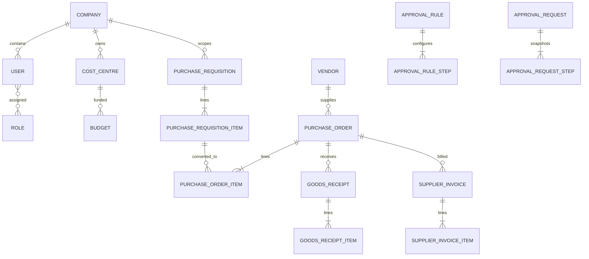

# Acme Procure to Pay

Laravel 10 with Blade views and MySQL. Laravel was selected for its migrations, validation, transactions, and server-rendered workflow support.

## Run locally

1. With Docker Compose installed, run `docker compose up --build` and open `http://localhost:8000`. The container installs dependencies, generates an app key, migrates, and seeds. `docker compose down` stops the services; `docker compose down -v` also removes the local database volume.
2. For a manual setup, install PHP 8.1+ with BCMath, Composer, and MySQL 8/MariaDB 10.6+.
3. Copy `.env.example` to `.env`; configure the database and set `APP_URL`.
4. Run `composer install`, `php artisan key:generate`, `php artisan migrate --seed`, then `php artisan serve`.
5. Sign in with any listed account below. Password for all seeded users is `password`.

## Render deployment (Docker + TiDB Cloud)

Create a Render **Web Service** from this GitHub repository and select the Docker runtime. Leave the build and start commands blank so Render builds `Dockerfile` and runs its Apache entrypoint. Apache binds to Render's `PORT`; Composer installs only production dependencies while the image is built, before the service starts.

Add these environment variables in Render. Generate `APP_KEY` locally with `php artisan key:generate --show`; keep the key private. In TiDB Cloud, create a dedicated empty database (for example `procure_to_pay`) for the app instead of using the `sys` system database. The container runs `php artisan migrate --seed --force` on startup.

```text
APP_ENV=production
APP_DEBUG=false
APP_KEY=base64:<generated-key>
APP_URL=https://<your-render-service>.onrender.com
DB_CONNECTION=mysql
DB_HOST=<TiDB-host>
DB_PORT=4000
DB_DATABASE=procure_to_pay
DB_USERNAME=<TiDB-username>
DB_PASSWORD=<TiDB-password>
MYSQL_ATTR_SSL_CA=/etc/ssl/certs/ca-certificates.crt
CACHE_DRIVER=file
SESSION_DRIVER=file
SESSION_SECURE_COOKIE=true
QUEUE_CONNECTION=sync
```

After the first deploy, check Render logs for successful migrations and the `Listening`/Apache startup. If the service fails, share the first Laravel/PDO error line from the deploy/runtime logs, with credentials redacted.

## InfinityFree shared-host deployment

The free InfinityFree plan does not provide SSH, Git, Composer, or Artisan on the server. Prepare the app locally, upload it with FTP, and import `database/infinityfree_seed.sql` through phpMyAdmin.

1. Create a MySQL database in the InfinityFree control panel and note its exact hostname, database name, username, and password. The free plan does not allow a remote app such as TiDB or Render to connect to this MySQL database; the Laravel app must run on the same InfinityFree account.
2. On the local project, run `composer install --no-dev --no-interaction --prefer-dist` and `composer dump-autoload --no-dev --optimize=false`. Build frontend assets locally if needed; do not upload `node_modules`.
3. Create a production `.env` locally with `APP_ENV=production`, `APP_DEBUG=false`, the actual `APP_URL`, the MySQL credentials from the control panel, `CACHE_DRIVER=file`, `SESSION_DRIVER=file`, and `QUEUE_CONNECTION=sync`. Use a generated `APP_KEY`. Never commit or publish this `.env`.
4. Upload the Laravel project contents, including `vendor`, to the account's `htdocs` directory. The root `.htaccess` forwards requests to `public/`; keep Laravel's `public/.htaccess` in place. Do not upload `.git`, `node_modules`, or local log/cache contents.
5. In phpMyAdmin, select the new app database and import `database/infinityfree_seed.sql`. This dump contains the schema, migration records, and Appendix A demo seed data, so do not run `php artisan migrate` or `db:seed` on the host.
6. Check file permissions for `storage` and `bootstrap/cache`, then open the provided domain and test login/workflows.

InfinityFree's free plan has no cron or background workers, so the scheduled 48-hour reminder command will not run there. The app's synchronous request handling and database-backed in-app notices remain available.

Seed users include those accounts, plus backup approvers `depthead.backup.mum@acme.test` and `depthead.backup.blr@acme.test`, and Bengaluru IT Head, Finance Head, CFO, Store Keeper, and Accounts accounts with the matching `*.blr@acme.test` address prefix. All use password `password`.

## Data model overview



## Workflow notes

- Approval rules are seeded per company as user assignments, since the existing schema stores approver user IDs. The chain is copied into approval request steps at submission. IT category purchases add IT Head after Dept Head, before any amount-based Finance Head/CFO stages.
- When the configured approver is also the requester, submission snapshots another same-company user with the same approver role.
- PR, PO, GRN, and invoice quantities retain their selected units. GRN and invoice quantities convert into the linked PO unit for tolerance and match checks. Accepted GRN quantities alone count toward the 5% limit.
- Status changes on PRs, POs, GRNs, and invoices append to `audit_logs`. The app exposes no update/delete path for those records.
- FY budget rows for Appendix A are seeded for 2026-27. PO budget updates use row locks.

## Known gaps

The application implements the core Tier 1 workflow, Tier 2 payments/TDS, ledger/ageing, and the requested operational reports, plus in-app notices and scheduled 48-hour reminders. The repository includes feature tests and a MySQL CI workflow; the suite should be run in CI before delivery. Remaining assignment work: configure SSO, and deploy a hosted demo. Hosting requires an external account/domain and deployment credentials; no such target was supplied. The approval-rule UI stores approver users in ordered steps, so an admin changes chains by editing those steps.
