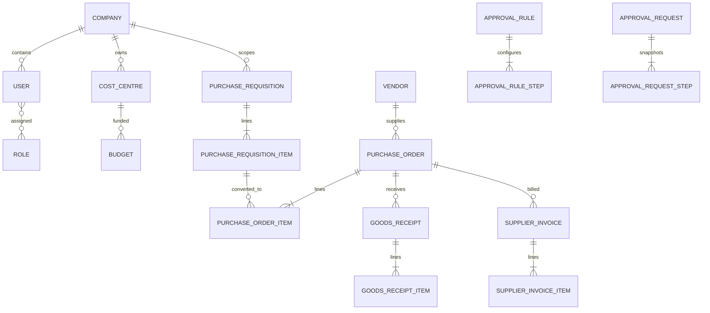

# Acme Procure to Pay

Laravel 10 with Blade views and MySQL. Laravel was selected for its migrations, validation, transactions, and server-rendered workflow support.

## Run locally

1. With Docker Compose installed, run `docker compose up --build` and open `http://localhost:8000`. The container installs dependencies, generates an app key, migrates, and seeds. `docker compose down` stops the services; `docker compose down -v` also removes the local database volume.
2. For a manual setup, install PHP 8.1+ with BCMath, Composer, and MySQL 8/MariaDB 10.6+.
3. Copy `.env.example` to `.env`; configure the database and set `APP_URL`.
4. Run `composer install`, `php artisan key:generate`, `php artisan migrate --seed`, then `php artisan serve`.
5. Sign in with any listed account below. Password for all seeded users is `password`.

Seed users include those accounts, plus backup approvers `depthead.backup.mum@acme.test` and `depthead.backup.blr@acme.test`, and Bengaluru IT Head, Finance Head, CFO, Store Keeper, and Accounts accounts with the matching `*.blr@acme.test` address prefix. All use password `password`.

## Data model overview

## Workflow notes

- Approval rules are seeded per company as user assignments, since the existing schema stores approver user IDs. The chain is copied into approval request steps at submission. IT category purchases add IT Head after Dept Head, before any amount-based Finance Head/CFO stages.
- When the configured approver is also the requester, submission snapshots another same-company user with the same approver role.
- PR, PO, GRN, and invoice quantities retain their selected units. GRN and invoice quantities convert into the linked PO unit for tolerance and match checks. Accepted GRN quantities alone count toward the 5% limit.
- Status changes on PRs, POs, GRNs, and invoices append to `audit_logs`. The app exposes no update/delete path for those records.
- FY budget rows for Appendix A are seeded for 2026-27. PO budget updates use row locks.

## Known gaps

The application implements the core Tier 1 workflow, Tier 2 payments/TDS, ledger/ageing, and the requested operational reports, plus in-app notices and scheduled 48-hour reminders. The repository includes feature tests and a MySQL CI workflow; the suite should be run in CI before delivery. Remaining assignment work: configure SSO, and deploy a hosted demo. Hosting requires an external account/domain and deployment credentials; no such target was supplied. The approval-rule UI stores approver users in ordered steps, so an admin changes chains by editing those steps.
