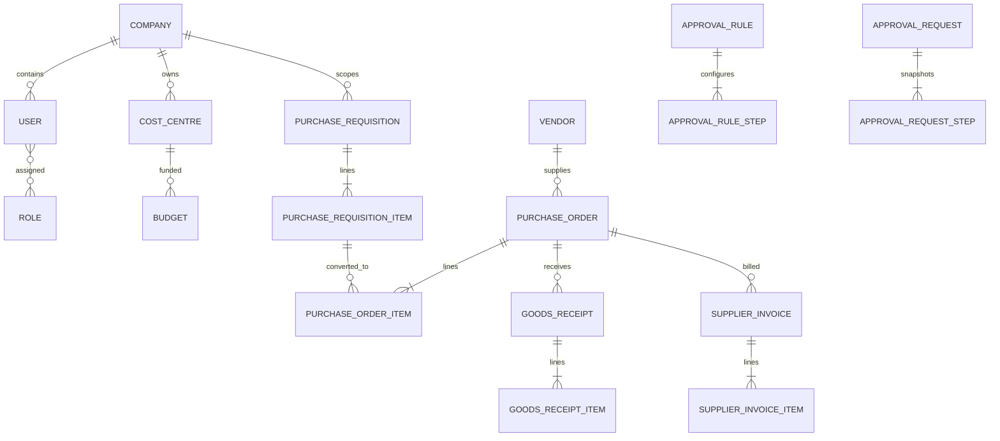

# Acme Procure to Pay

Laravel 10 with Blade views and MySQL. Laravel was selected for its migrations, validation, transactions, and server-rendered workflow support.

## Run locally

1. With Docker Compose installed, run `docker compose up --build` and open `http://localhost:8000`. The container installs dependencies, generates an app key, migrates, seeds, and starts the database queue worker and scheduler. `docker compose down` stops the services; `docker compose down -v` also removes the local database volume.
2. For a manual setup, install PHP 8.2+ with BCMath, Composer, and MySQL 8/MariaDB 10.6+.
3. Copy `.env.example` to `.env`; configure the database and set `APP_URL`.
4. Run `composer install`, `php artisan key:generate`, `php artisan migrate --seed`, then `php artisan serve`. In separate terminals, run `php artisan queue:work` and `php artisan schedule:work`.
5. Sign in with any listed account below. Password for all seeded users is `password`.

## Hosted demo and seeded logins

Live demo: https://procure-to-pay-1-gkc5.onrender.com/login

All demo accounts use password `password`.

| Company | Role(s) | Demo email |
|---|---|---|
| Mumbai | Admin | `admin.mum@acme.test` |
| Mumbai | Requester | `req.mum@acme.test` |
| Mumbai | Dept Head, Requester | `depthead.mum@acme.test` |
| Mumbai | Dept Head (backup approver) | `depthead.backup.mum@acme.test` |
| Mumbai | IT Head | `ithead.mum@acme.test` |
| Mumbai | Finance Head | `finhead.mum@acme.test` |
| Mumbai | CFO | `cfo.mum@acme.test` |
| Mumbai | Procurement Officer | `proc.mum@acme.test` |
| Mumbai | Store Keeper | `store.mum@acme.test` |
| Mumbai | Accounts | `accounts.mum@acme.test` |
| Bengaluru | Admin | `admin.blr@acme.test` |
| Bengaluru | Requester | `req.blr@acme.test` |
| Bengaluru | Dept Head | `depthead.blr@acme.test` |
| Bengaluru | Dept Head (backup approver) | `depthead.backup.blr@acme.test` |
| Bengaluru | IT Head | `ithead.blr@acme.test` |
| Bengaluru | Finance Head | `finhead.blr@acme.test` |
| Bengaluru | CFO | `cfo.blr@acme.test` |
| Bengaluru | Procurement Officer | `proc.blr@acme.test` |
| Bengaluru | Store Keeper | `store.blr@acme.test` |
| Bengaluru | Accounts | `accounts.blr@acme.test` |

## Composer dependencies

- `laravel/framework`: routing, Blade, validation, Eloquent ORM, queues, notifications, and database migrations.
- `laravel/sanctum`: Laravel API-token authentication support; the submitted application uses session-based Blade authentication.
- `guzzlehttp/guzzle`: Laravel HTTP client transport for possible external integrations; no external HTTP integration is required by the current workflow.
- `laravel/tinker`: interactive Laravel console for local development and database inspection.
- Development packages: PHPUnit runs the automated suite; Mockery supports test doubles; Faker generates factory data; Pint formats PHP; Collision and Laravel Ignition improve local CLI and debug output; Sail is available as an optional Laravel local-development helper.

## Render deployment (Docker + TiDB Cloud)

Create a Render **Web Service** from this GitHub repository and select the Docker runtime. Leave the build and start commands blank so Render builds `Dockerfile` and runs its Apache entrypoint. Apache binds to Render's `PORT`; Composer installs only production dependencies while the image is built, before the service starts. The container starts a database queue worker and the scheduler after migrations.

Add these environment variables in Render. Generate `APP_KEY` locally with `php artisan key:generate --show`; keep the key private. In TiDB Cloud, create a dedicated empty database (for example `procure_to_pay`) for the app instead of using the `sys` system database. The container runs `php artisan migrate --seed --force` on startup.

```text
APP_ENV=production
APP_DEBUG=false
APP_KEY=base64:<generated-key>
APP_URL=https://<your-render-service>.onrender.com
DB_CONNECTION=mysql
DB_HOST=<TiDB-host>
DB_PORT=4000
DB_DATABASE=procure_to_pay
DB_USERNAME=<TiDB-username>
DB_PASSWORD=<TiDB-password>
MYSQL_ATTR_SSL_CA=/etc/ssl/certs/ca-certificates.crt
CACHE_DRIVER=file
SESSION_DRIVER=file
SESSION_SECURE_COOKIE=true
QUEUE_CONNECTION=database
```

After the first deploy, check Render logs for successful migrations and the `Listening`/Apache startup. If the service fails, share the first Laravel/PDO error line from the deploy/runtime logs, with credentials redacted.

## Data model overview



## Automated tests

Run `php artisan test`. The suite includes 16 feature tests covering company isolation, role access, self-approval prevention, concurrent budget protection, unit conversion and GRN tolerance, 3-way match pass/hold cases, TDS, and partial payments. GitHub Actions runs the suite against MySQL 8 on pushes and pull requests.

## Workflow notes

- Approval rules are seeded per company as user assignments, since the existing schema stores approver user IDs. The chain is copied into approval request steps at submission. IT category purchases add IT Head after Dept Head, before any amount-based Finance Head/CFO stages.
- When the configured approver is also the requester, submission snapshots another same-company user with the same approver role.
- PR, PO, GRN, and invoice quantities retain their selected units. GRN and invoice quantities convert into the linked PO unit for tolerance and match checks. Accepted GRN quantities alone count toward the 5% limit.
- Status changes on PRs, POs, GRNs, and invoices append to `audit_logs`; payments record a `RECORDED` audit event. The app exposes no update/delete path for audit records.
- FY budget rows for Appendix A are seeded for 2026-27. PO budget updates use row locks.
- `database/procure_to_pay.sql` contains the MySQL schema and Appendix A demo master data for import into a fresh database.

## Known gaps

The application implements the Tier 1 workflow, Tier 2 payments/TDS, vendor ledger/ageing, operational reports, in-app notifications, and a scheduled 48-hour reminder command. The assignment's optional SSO integration is not implemented; email delivery is also not configured (notifications are in-app). The hosted demo and MySQL-backed CI workflow are available. The approval-rule UI stores approver users in ordered steps, so an admin changes chains by editing those steps.
